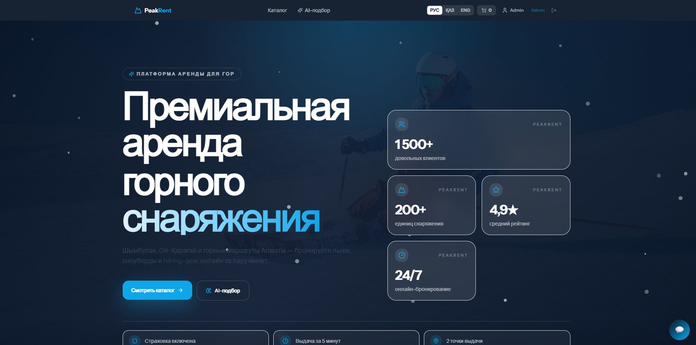
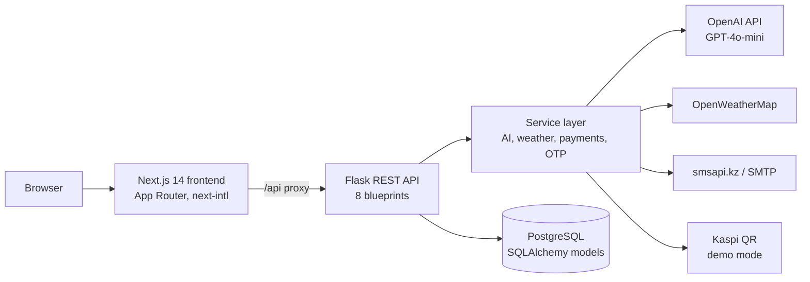
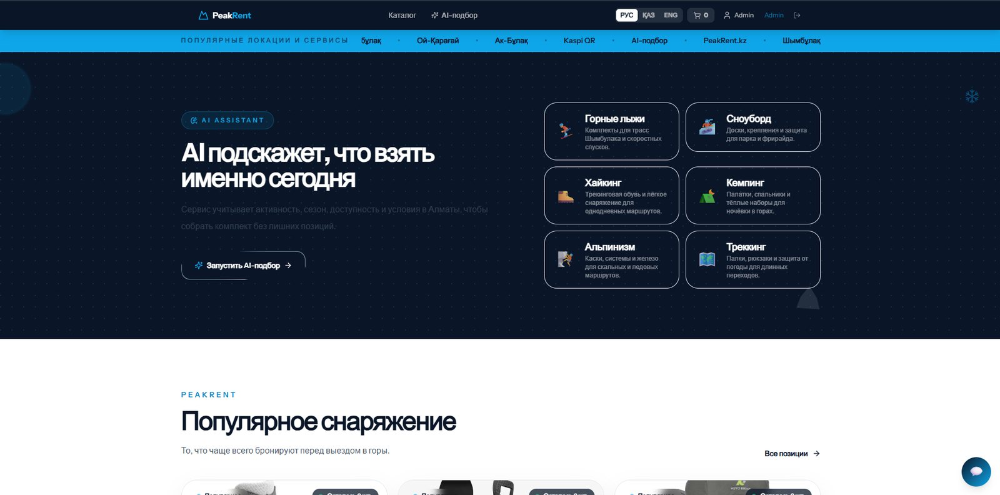
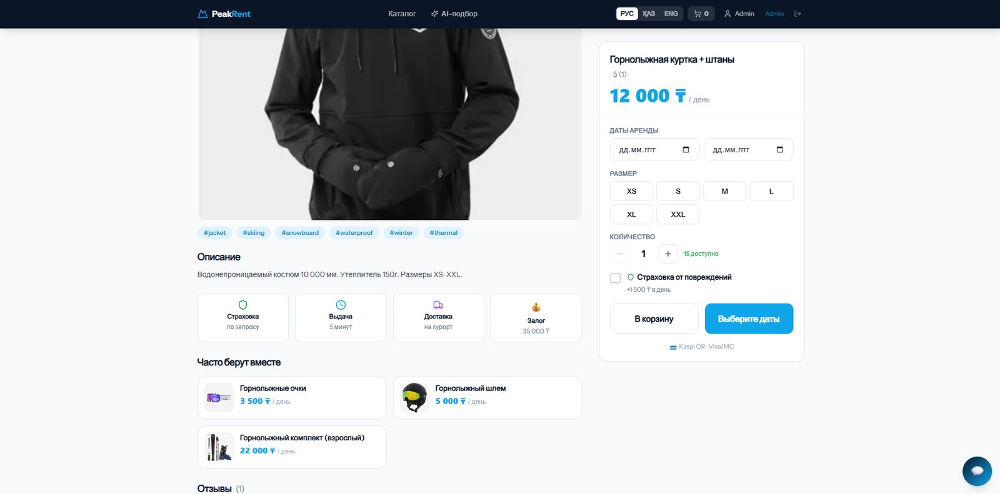

# PeakRent.kz

Mountain gear rental service for Almaty: catalog, booking and payment, AI gear recommendations that take the weather into account, and an AI chat that answers from the real catalog. Graduation project, International Information Technology University (IITU), 2026.



## Features

- Catalog with categories, filters, product pages, sizes and availability for the chosen dates
- Cart, booking and a Kaspi QR or card payment flow (demo mode without merchant keys)
- Sign-in with a one-time code (SMS through smsapi.kz or email) and JWT; client, manager and admin roles
- AI gear picker: asks for the activity and level, checks the weather in Almaty and builds a kit
- AI chat widget that recommends only items that exist in the catalog
- Reviews, favorites and "often rented together"
- Admin panel: products with image upload, bookings and their statuses, users, sales analytics and CSV export
- Interface in Russian, Kazakh and English

## Architecture



The backend uses the application factory pattern (`app/__init__.py`). Routes are Flask blueprints, business logic lives in `app/services`, and data access goes through SQLAlchemy models. On the first start the app creates the tables and fills an empty database with demo data.

### How the recommendations work

1. The backend turns the chosen activity, level, weather and temperature into a set of target tags. If the request has no weather, it asks OpenWeatherMap.
2. Every active item with free stock for the dates gets a score. Tag overlap carries most of the weight (52%), then rental popularity over the last 30 days (18%), plus small bonuses for peak season, featured items, stock and safety gear. Items the same user rented in the last 14 days and items over the budget lose points.
3. The top 6 items go to GPT-4o-mini, which writes one short tip for each: why it fits today, a safety hint and a next step. If the OpenAI call fails, the API returns rule-based reasons, so the page works without a key.

The chat works the same way: the backend picks up to 24 catalog items that match the conversation and passes them to the model with an instruction to recommend only those items.

Code: [`ai_service.py`](peakrent_refactored/backend/app/services/ai_service.py).

## Tech stack

| Part | Tools |
| --- | --- |
| Backend | Python, Flask 3.1, Flask-SQLAlchemy, PostgreSQL, PyJWT, Flask-CORS, OpenAI SDK, requests, gunicorn |
| Frontend | Next.js 14 (App Router), TypeScript, Tailwind CSS, React Query, Zustand, next-intl, react-hook-form, zod |
| Integrations | OpenAI (GPT-4o-mini), OpenWeatherMap, smsapi.kz, SMTP, Kaspi QR (demo) |

## Run locally

You need Python 3.10+, Node.js 18.17+ and PostgreSQL.

Backend:

```bash
cd peakrent_refactored/backend
python -m venv venv
source venv/bin/activate        # Windows: venv\Scripts\activate
pip install -r requirements.txt
cp .env.example .env            # set DATABASE_URL; API keys are optional
python run.py                   # http://localhost:5000
```

Create the database first, for example with `createdb peakrent`. Tables and demo data appear on the first start.

Frontend, in a second terminal:

```bash
cd peakrent_refactored/frontend
cp .env.example .env.local
npm install
npm run dev                     # http://localhost:3000/ru
```

Demo accounts from `seed.py` (local data only):

| Role | Phone | Email / password |
| --- | --- | --- |
| Admin | +77000000000 | admin@peakrent.kz / admin123 |
| Manager | +77000000001 | manager@peakrent.kz / manager123 |

With `DEV_OTP_BYPASS=true` any phone number signs in with the code `123456`.

## Environment variables

| Variable | Needed for |
| --- | --- |
| `DATABASE_URL` | PostgreSQL connection (required) |
| `SECRET_KEY`, `JWT_SECRET` | signing sessions and tokens; set your own values in production |
| `OPENAI_API_KEY`, `OPENAI_MODEL` | AI tips and chat; without a key the app uses rule-based texts |
| `OPENWEATHER_API_KEY` | live weather; without it the app uses demo weather |
| `DEV_OTP_BYPASS` | `true` makes every one-time code `123456` |
| `SMSAPI_TOKEN`, `SMTP_*` | real code delivery by SMS or email |
| `KASPI_*` | real Kaspi payments |
| `NEXT_PUBLIC_API_URL` | frontend: backend address, `http://localhost:5000/api` by default |

The full lists are in [`backend/.env.example`](peakrent_refactored/backend/.env.example) and [`frontend/.env.example`](peakrent_refactored/frontend/.env.example).

## API overview

| Area | Endpoints |
| --- | --- |
| Auth | `POST /api/auth/send-otp`, `/verify-otp`, `/register`, `/login`; `GET` and `PUT /api/auth/me` |
| Catalog | `GET /api/equipment`, `/categories`, `/featured`, `/{slug}`; `POST /api/equipment/availability`; favorites |
| Bookings | `POST /api/bookings`; `GET /api/bookings/my`, `/{id}`; `DELETE /api/bookings/{id}` |
| Payments | `POST /api/payments/kaspi/init`, `/card/init`; `GET /api/payments/{id}/status`; Kaspi webhook |
| AI | `POST /api/recommendations`, `/api/ai/chat`, `/api/ai/suggest`; `GET /api/recommendations/related` |
| Reviews, weather | `GET /api/reviews/{equipment_id}`, `POST /api/reviews`; `GET /api/weather` |
| Admin | stats and analytics, CSV export, bookings and statuses, users, products with image upload |

## Project structure

```
peakrent_refactored/
├── backend/
│   ├── run.py              # entry point
│   └── app/
│       ├── __init__.py     # create_app(), blueprints, first-run seeding
│       ├── config.py       # settings from environment variables
│       ├── models/         # User, Equipment, Category, Booking, Review, Favorite
│       ├── routes/         # REST API blueprints
│       ├── services/       # AI, chat, weather, payments, SMS and email
│       └── utils/auth.py   # JWT and role decorators
└── frontend/
    └── src/
        ├── app/[locale]/   # catalog, product, cart, checkout, AI picker, profile, manager, admin
        ├── components/     # navbar, chat widget, providers
        ├── i18n/           # ru, kk, en
        └── lib/            # API client, hooks, Zustand stores, types
```

## Screenshots

| AI picker | Product page and booking |
| --- | --- |
|  |  |

## Author

Yerassyl Yermekov, junior Python / backend developer. Portfolio: [cv-yerassyl.vercel.app](https://cv-yerassyl.vercel.app/?lang=en) · Telegram: [@eeermekov](https://t.me/eeermekov)
